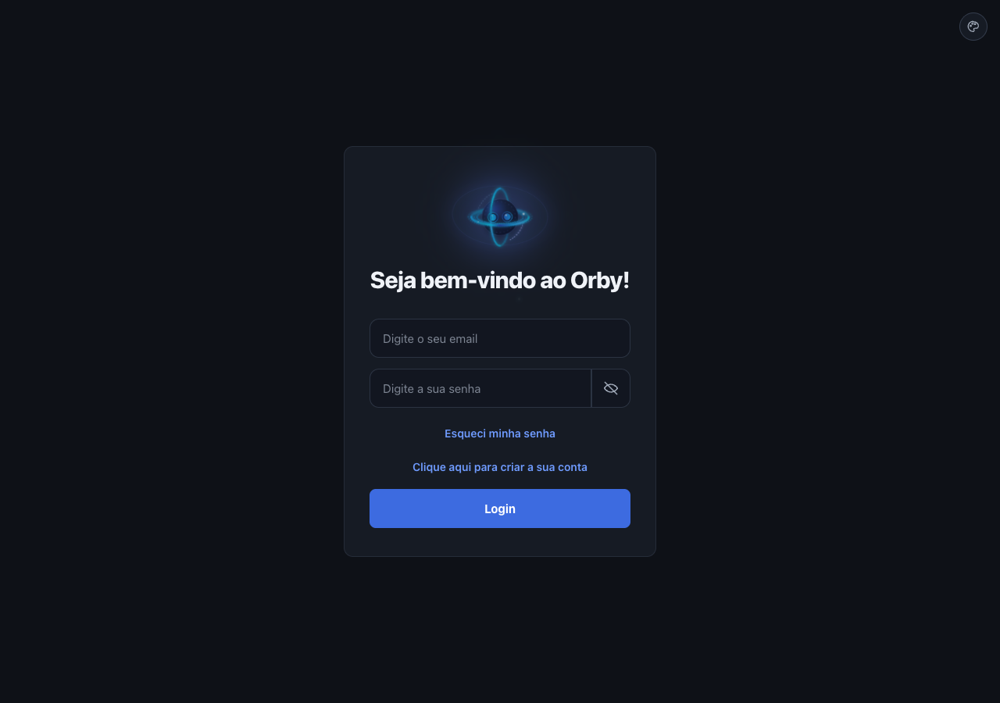
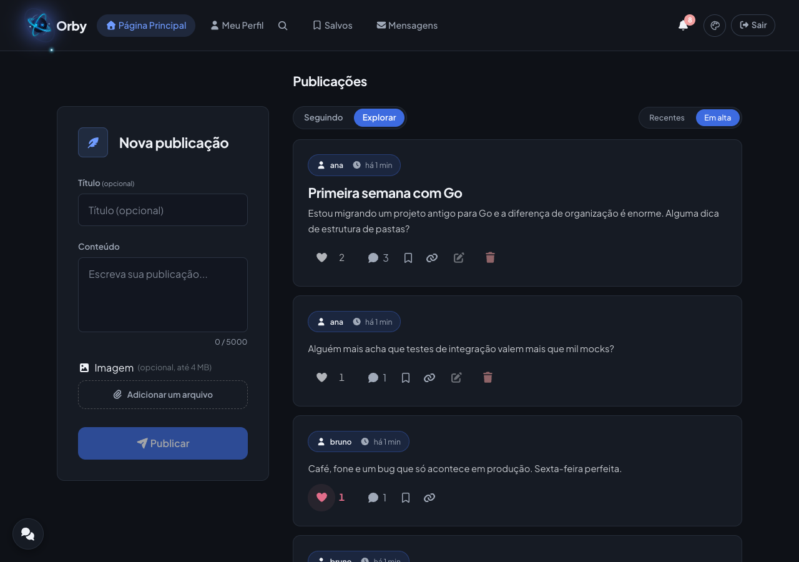

# Orby API

API do **Orby**, uma rede social pequena feita em Go + MySQL. O front fica em [`orby-front`](https://github.com/rgssb/orby-front).

## O que tem

- Publicações com título opcional, imagem, comentários e menções (`@nick`)
- Feeds **Seguindo**, **Explorar** e **Em alta** (curtidas + comentários dos últimos 7 dias, peso igual)
- Salvos, curtidas, seguir e pedidos para seguir
- Conta privada: só o dono e quem o segue veem posts, comentários e imagens
- Bloqueio e direct em tempo real (SSE), com limite de mensagens até a resposta e pedido de desculpas para bloqueados
- Silenciar usuários: as publicações somem dos feeds (sem avisar a pessoa), mas o perfil continua acessível
- Notificações, recuperação de senha por e-mail, limite de tentativas de login
- Fotos, banners e imagens ficam em disco (`MEDIA_DIR`), não no MySQL; arquivos órfãos são limpos a cada 24 h





## Rodando com Docker

Com `orby-back` e `orby-front` clonados lado a lado:

```sh
cp .env.docker.example .env.docker   # troque as senhas e chaves
docker compose --env-file .env.docker up --build
```

Abra http://localhost:3000. Os dados ficam nos volumes `dados` (MySQL) e `midia` (imagens); faça backup dos dois.

## Rodando sem Docker

1. Crie o banco `orby` no MySQL (as tabelas são criadas ao iniciar a API).
2. Copie `.env.example` para `.env` e preencha (`DB_HOST` é opcional; sem ele usa o socket local).
3. `go run .`

## Testes

Os testes de banco usam um MySQL real e só rodam com `ORBY_TEST_DSN` apontando para um banco cujo nome termine em `_test` (as tabelas são recriadas a cada teste):

```sh
mysql -u root -p -e "CREATE DATABASE orby_test"
ORBY_TEST_DSN='usuario:senha@/orby_test?parseTime=True' go test ./...
```

Sem a variável, esses testes são pulados. O CI (`.github/workflows/ci.yml`) sobe um MySQL e roda tudo.
